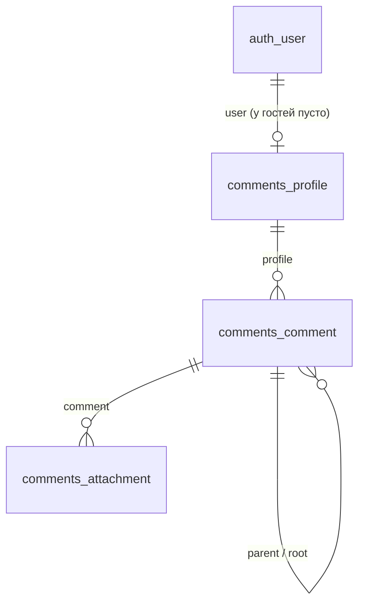

# Комментарии

SPA-приложение для тестового задания dZENcode (уровень Junior+). Это страница, на которой можно оставлять комментарии, отвечать на чужие, прикреплять к сообщению картинку или текстовый файл и сразу видеть новые комментарии других людей без обновления страницы.

Бэкенд на Django, фронтенд на Vue, база PostgreSQL, всё упаковано в Docker.

Демо: _сюда вставить ссылку после деплоя_

## Что умеет приложение

### Комментарии

- Форма с полями User Name, E-mail, Home page, CAPTCHA и Text. User Name только латиницей и цифрами, E-mail по формату, Home page необязателен и принимает только адреса с http или https.
- CAPTCHA с картинкой, нужна всем, в том числе зарегистрированным. Ответ хранится на сервере, работает один раз и живёт 5 минут.
- В тексте разрешены теги `<a href="" title="">`, `<code>`, `<i>`, `<strong>`. Всё остальное вырезается. Теги проверяются регулярными выражениями по правилам XHTML: имена маленькими буквами, значения атрибутов в двойных кавычках, у `<a>` обязателен `href`, каждый открытый тег должен быть закрыт в правильном порядке. Если что-то не так, форма говорит, что именно исправить.
- Над полем текста есть кнопки `[i]`, `[strong]`, `[code]`, `[a]`: они оборачивают выделенный фрагмент в тег.
- Предпросмотр сообщения работает без перезагрузки страницы. Он проходит через тот же код очистки, что и сохранение, поэтому в предпросмотре видно ровно то, что сохранится.
- Валидация и в браузере, и на сервере. Серверной я доверяю, браузерная нужна для удобства.
- На любой комментарий можно ответить, глубина ответов не ограничена, они показываются каскадом.

### Список комментариев

- Заглавные комментарии (те, что не ответы) выводятся таблицей с колонками User Name, E-mail и Дата. Клик по заголовку колонки сортирует, повторный клик меняет направление.
- По умолчанию новые сверху (LIFO).
- На странице 25 заглавных комментариев, внизу переключатель страниц.
- Новый комментарий появляется у всех, кто открыл страницу, через WebSocket.

### Файлы

- Картинки JPG, GIF, PNG. Если картинка больше 320×240, она пропорционально уменьшается. У анимированных GIF анимация сохраняется.
- Текстовые файлы `.txt` не больше 100 КБ.
- Просмотр файлов в lightbox: картинка открывается поверх страницы с плавным увеличением, txt показывается как текст.

### Пользователи и профили

- User Name уникален без учёта регистра. Если имя занято другим человеком, форма отвечает «Имя пользователя занято».
- E-mail привязан только к одному имени. Нельзя писать под двумя разными именами с одним адресом.
- Незарегистрированный пользователь заполняет поля User Name, E-mail и Home page при каждой отправке. Если он пишет под тем же именем и с тем же e-mail, это тот же профиль.
- Можно зарегистрироваться (пароль от 6 символов, в нём должны быть и буквы, и цифры). Тогда поля User Name, E-mail и Home page подставляются в форму сами. При регистрации Home page создаётся автоматически и ведёт на профиль пользователя.
- Если зарегистрироваться с именем и e-mail, под которыми уже писали без регистрации, профиль закрепляется за аккаунтом вместе со всей историей комментариев.
- Профиль создаётся при регистрации или при первом сообщении под новым именем и открывается по ссылке `/#/u/<имя>`. На нём все публичные комментарии пользователя и ссылки «Открыть ветку» (`/#/c/<id>`), которые открывают всю ветку и подсвечивают нужный комментарий.
- Переключатель «Отправить анонимно» есть у всех, поля при этом всё равно обязательны. Другим пользователям вместо имени показывается «Аноним», без e-mail и сайта, и такой комментарий не попадает в публичный профиль. Автор при этом системе известен.
- Переключатель «Показывать Home page» решает, будет ли ссылка на сайт видна рядом с конкретным комментарием.
- E-mail публично не показывается, в списке виден только вид `j***@example.com`.

### Что сделано для уровня Junior+

- Queue: Celery с Redis. Картинки уменьшаются в фоне (пока идёт обработка, у вложения статус «Обработка файла…»). Там же отправляется письмо автору комментария, когда ему ответили.
- Cache: Redis. В кеше лежит список комментариев (ключ зависит от сортировки и страницы) и CAPTCHA.
- Events: сигналы Django. При создании комментария сигнал сбрасывает кеш, ставит задачи в Celery и отправляет событие по WebSocket.
- JWT: вход и регистрация выдают пару токенов. Access живёт час, потом фронтенд сам получает новый по refresh-токену (он живёт 7 дней).
- WebSocket: Django Channels.

## Стек

- Backend: Python 3.12, Django, Django REST Framework, Django ORM, Channels (Daphne), Celery, simplejwt, Pillow, nh3 (очистка HTML).
- Frontend: Vue 3 и Vite.
- База: PostgreSQL в Docker, SQLite при запуске без Docker.
- Инфраструктура: Redis, nginx, Docker Compose.

## Как запустить

Нужен Docker.

```
git clone <ссылка на репозиторий>
cd dzen-comments
cp .env.example .env
docker compose up --build
```

На Windows вместо `cp` команда `copy .env.example .env`.

Когда всё поднялось, приложение доступно на http://localhost:8080. Запускается пять контейнеров: db, redis, backend, celery и frontend (nginx, он же отдаёт загруженные файлы и проксирует `/api` и `/ws`).

Остановить: `docker compose down`. Вместе с данными (база и загруженные файлы): `docker compose down -v`.

Если запускать на сервере, в `.env` обязательно замените `SECRET_KEY` на свою длинную случайную строку и поставьте свой домен в `ALLOWED_HOSTS`. Порт сайта задаётся переменной `WEB_PORT` (по умолчанию 8080, на сервере удобно поставить 80).

### Тесты

```
docker compose run --rm backend python manage.py test comments
```

Сейчас их 72: очистка HTML, создание комментариев и ошибки валидации, CAPTCHA, дерево ответов, пагинация и сортировка, загрузка и уменьшение картинок, лимит на txt, JWT, профили, правила имён и e-mail, XSS и SQL-инъекции. Для тестов проект сам переключается на SQLite и кеш в памяти, поэтому Redis и Postgres им не нужны.

Если вы меняли код, перед тестами пересоберите образ: `docker compose build`.

### Запуск без Docker

Если не заданы `REDIS_URL` и `POSTGRES_HOST`, проект работает на SQLite и кеше в памяти, а Celery выполняет задачи сразу в том же процессе. Воркер не нужен.

```
cd backend
pip install -r requirements.txt
python manage.py migrate
python manage.py runserver
```

В другом окне:

```
cd frontend
npm install
npm run dev
```

Фронтенд откроется на http://localhost:5173 и сам проксирует запросы на порт 8000.

## Как пользоваться

1. Откройте http://localhost:8080. Вверху форма нового комментария, ниже таблица с уже написанными.
2. Заполните User Name, E-mail и текст, введите символы с картинки CAPTCHA и нажмите «Отправить». Кнопки `[i]`, `[strong]`, `[code]`, `[a]` над полем текста вставляют теги, «Предпросмотр» показывает результат без отправки.
3. К сообщению можно прикрепить картинку или txt. Клик по картинке или по имени файла открывает его в lightbox, Esc или клик мимо закрывает.
4. «Ответить» под комментарием открывает такую же форму, ответ появляется внутри ветки.
5. Клик по заголовкам User Name, E-mail, Дата в таблице меняет сортировку. Страницы переключаются внизу.
6. «Войти / регистрация» вверху: после регистрации первые три поля формы заполняются сами. Там же ссылка «Мой профиль».
7. Галочка «Отправить анонимно» прячет имя, e-mail и сайт от других. Галочка «Показывать Home page» убирает ссылку на сайт у этого комментария.
8. Клик по имени автора открывает его профиль, клик по дате комментария открывает ветку с ним.

### Как проверить Junior+

- Queue: загрузить картинку больше 320×240. Сначала у неё статус «Обработка файла…», потом появится миниатюра. В `docker compose logs celery` видна задача `process_attachment`.
- Cache: запросить `/api/comments/` два раза подряд, второй ответ берётся из Redis. Ключ содержит номер версии, он растёт с каждым новым комментарием, поэтому кеш сбрасывается сам.
- Events и WebSocket: открыть страницу в двух окнах, отправить комментарий в одном, во втором он появится сам.
- JWT: создать аккаунт, первые три поля формы заполнены и заблокированы. Токены лежат в `localStorage` браузера.

## API

| Метод | URL | Что делает |
|---|---|---|
| GET | `/api/comments/?ordering=-created_at&page=1` | заглавные комментарии с деревом ответов |
| POST | `/api/comments/` | создать комментарий (multipart, можно с файлом) |
| POST | `/api/comments/preview/` | предпросмотр текста |
| GET | `/api/comments/<id>/thread/` | вся ветка, в которой написан комментарий |
| GET | `/api/users/<имя>/` | публичный профиль и его комментарии |
| GET | `/api/auth/me/` | свой профиль (для автозаполнения формы) |
| GET | `/api/captcha/` | ключ и картинка CAPTCHA |
| POST | `/api/auth/register/` | регистрация, возвращает токены |
| POST | `/api/auth/token/` | вход |
| POST | `/api/auth/token/refresh/` | обновить токен |
| WS | `/ws/comments/` | события `comment.created` и `comment.updated` |

`ordering` принимает `user_name`, `email`, `created_at`, с минусом в начале для обратного порядка. Любое другое значение игнорируется.

## Защита

- XSS: текст очищается на сервере по белому списку тегов (nh3) до сохранения, ссылки только с http и https. На фронтенде текст выводится только после очистки. Текст из txt-файла показывается как обычный текст, не как HTML.
- SQL-инъекции: все запросы идут через Django ORM, поля сортировки берутся из заранее заданного списка, id в адресе принимается только числом.
- Остальные поля формы проверяются на сервере: имя только латиницей и цифрами, e-mail по формату, Home page только http и https.
- Файлы проверяются по содержимому, а не только по расширению: картинку открывает Pillow, у txt проверяется кодировка UTF-8 и отсутствие нулевых байтов. Картинки ограничены по размеру в пикселях (защита от «бомб»), SVG и подделки под картинки не принимаются.
- nginx отдаёт заголовки `Content-Security-Policy`, `X-Content-Type-Options` и `X-Frame-Options`. Загруженные файлы в `/media/` отдаются с запретом исполнения.
- Приватность: e-mail в API маскируется, анонимные комментарии отдаются без автора, а сортировка для них идёт по «Аноним», чтобы порядок в списке не выдавал автора.
- В тестах есть отдельный набор на XSS и SQL-инъекции (поля, текст, сортировка, адреса, вход).

## Устройство проекта

```
backend/
  config/            настройки, asgi, celery
  comments/
    models.py        Profile, Comment, Attachment
    services/        очистка HTML, CAPTCHA, правила имён и e-mail, файлы
    serializers.py   валидация входных данных
    views.py         API
    signals.py       события при создании комментария и вложения
    tasks.py         задачи Celery
    consumers.py     WebSocket
    tests/
frontend/src/        Vue: App (маршруты по hash), форма, узел комментария, профиль, ветка, lightbox, вход
docs/schema.sql      схема БД
```

### Модель данных



Профиль вынесен в отдельную таблицу: имя и e-mail уникальны (без учёта регистра, через индексы по `LOWER`), а у гостей нет связи с `auth_user`. Данные для идентификации клиента (IP и браузер) хранятся у самого комментария, потому что у одного человека они могут меняться. У комментария два поля: `parent` (кому ответили) и `root` (корень ветки). Благодаря `root` страницу из 25 заглавных комментариев со всеми ответами можно загрузить двумя запросами и собрать дерево уже в памяти, без запроса на каждый ответ.

Файл `docs/schema.sql` в диалекте MySQL, чтобы его открыть в MySQL Workbench: File, New Model, File, Import, Reverse Engineer MySQL Create Script. Реально проект работает на PostgreSQL, структура таблиц та же.

## Что можно было бы улучшить

- Нет ограничения частоты запросов, на открытом сервере его стоит добавить.
- E-mail не подтверждается письмом. Гостевой профиль определяется парой «имя + e-mail», поэтому, зная их, можно писать от чужого имени. Для настоящего сервиса нужна проверка адреса.
- Профиль и ветки открываются по ссылкам вида `/#/...`: я использовал hash-маршруты, чтобы не добавлять vue-router.
- Картинка уменьшается после сохранения и перезаписывает оригинал. Если оригиналы нужны, их надо хранить отдельно.
- Нет удаления и модерации комментариев.
- Письмо при ответе по умолчанию уходит в консоль (`console` backend), для настоящей отправки нужны настройки SMTP в `.env`.
