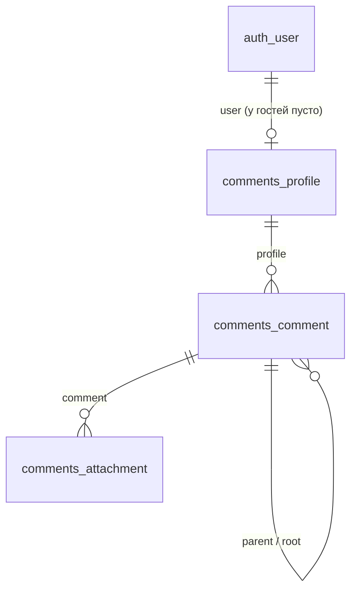

# Комментарии: SPA на Django и Vue

Тестовое задание для dZENcode, уровень Junior+.

Одностраничное приложение, в котором можно оставлять комментарии, отвечать на них (вложенность любая) и прикреплять к сообщению картинку или текстовый файл. Все данные лежат в реляционной базе, вместе с данными о том, кто писал: имя, e-mail, IP и браузер.

Демо: _сюда вставить ссылку после деплоя_

## Что есть в приложении

**Форма**
- User Name (латиница и цифры) обязателен и уникален: если такое имя уже занято другим человеком, форма отвечает «Имя пользователя занято». Сравнение без учёта регистра.
- E-mail обязателен и привязан только к одному имени. Нельзя написать под двумя разными именами с одним адресом.
- У каждого пользователя есть профиль на нашем сайте (см. ниже). При регистрации Home page создаётся автоматически и ведёт на этот профиль. Гость в форме комментария может указать свой Home page сам, это необязательно.
- CAPTCHA с картинкой нужна всем, в том числе зарегистрированным. Ответ хранится на сервере и работает один раз, живёт 5 минут.
- В тексте можно использовать только `<a href="" title="">`, `<code>`, `<i>`, `<strong>`. Остальной HTML вырезается. Теги должны быть правильно закрыты и вложены, иначе форма вернёт ошибку.
- Над полем текста есть кнопки `[i]`, `[strong]`, `[code]`, `[a]`, они оборачивают выделенный фрагмент.
- Предпросмотр работает без перезагрузки страницы и идёт через тот же код очистки, что и сохранение, так что то, что видно в предпросмотре, и сохранится.
- Валидация есть и в браузере, и на сервере. Серверной проверке я доверяю, проверка в браузере нужна только для удобства.
- Переключатель «Отправить анонимно» есть и у гостей, и у зарегистрированных. Поля при этом всё равно обязательны, но другим пользователям вместо имени показывается «Аноним», без e-mail и сайта. Сам автор системе известен, но такие комментарии не попадают в его публичный профиль.

**Пользователи и профили**
- Незарегистрированный пользователь заполняет поля 1-3 при каждой отправке. Если он повторно пишет под тем же именем с тем же e-mail, это тот же профиль.
- Профиль создаётся при регистрации или при первом сообщении под новым именем.
- Можно зарегистрироваться, тогда поля User Name, E-mail и Home page подставляются в форму сами (только для чтения).
- Если зарегистрироваться с именем и e-mail, под которыми уже писали как гость, профиль закрепляется за аккаунтом вместе со всей историей комментариев. Если имя занято чужим e-mail или зарегистрированным аккаунтом, будет «Имя пользователя занято».
- Профиль открывается по ссылке `/#/u/<имя>`. На нём видны все публичные комментарии пользователя, и у каждого есть ссылка «Открыть ветку» (`/#/c/<id>`), которая открывает всю ветку и подсвечивает этот комментарий.
- E-mail публично не показывается: в списке виден только вид `j***@example.com`.

**Список**
- Заглавные комментарии (не ответы) выводятся таблицей и идут страницами по 25.
- Сортировка кликом по заголовкам колонок User Name, E-mail и Дата, в обе стороны. По умолчанию новые сверху (LIFO).
- Ответы показываются каскадом под своим комментарием, глубина не ограничена.

**Файлы**
- Картинки JPG, GIF, PNG. Всё, что больше 320×240, пропорционально уменьшается.
- Текстовые файлы только `.txt` и не больше 100 КБ.
- Просмотр в lightbox: картинка открывается поверх страницы, txt показывается как текст.

**Junior+**
- Queue: Celery с Redis. Картинки уменьшаются в фоне, пока идёт обработка, у вложения статус «Обработка файла…». Там же уходит письмо автору комментария, когда ему ответили.
- Cache: Redis. Кешируется список комментариев (ключ зависит от сортировки и страницы), CAPTCHA тоже лежит там.
- Events: сигналы Django. При создании комментария сигнал сбрасывает кеш, ставит задачи в Celery и отправляет событие по WebSocket.
- JWT: регистрация и вход. Access-токен живёт час, после этого фронтенд сам получает новый по refresh-токену (он живёт 7 дней), так что пользователя не выкидывает из аккаунта. Пароль не короче 6 символов, в нём должны быть и буквы, и цифры. После входа поля User Name, E-mail и Home page заполняются сами.
- WebSocket (Django Channels): новый комментарий появляется у всех, кто открыл страницу, без обновления.

## Стек

Backend: Python 3.12, Django, Django REST Framework, Django ORM, Channels (Daphne), Celery, simplejwt, Pillow, nh3 (очистка HTML).
Frontend: Vue 3 + Vite.
База: PostgreSQL в Docker, SQLite если запускать без Docker.
Инфраструктура: Redis, nginx, Docker Compose.

## Как запустить

Нужен Docker.

```
git clone <ссылка на репозиторий>
cd dzen-comments
cp .env.example .env
docker compose up --build
```

На Windows вместо `cp` команда `copy .env.example .env`.

После запуска приложение будет на http://localhost:8080. Поднимается пять контейнеров: db, redis, backend, celery и frontend (nginx, он же отдаёт загруженные файлы и проксирует `/api` и `/ws`).

Тесты:

```
docker compose run --rm backend python manage.py test comments
```

Сейчас их около 70: санитайзер, создание и ошибки валидации, CAPTCHA, дерево ответов, пагинация и сортировка, загрузка и уменьшение картинки, лимит на txt, JWT. При запуске тестов проект сам переключается на SQLite и кеш в памяти, поэтому Redis и Postgres для них не нужны.

### Без Docker

Если `REDIS_URL` и `POSTGRES_HOST` не заданы, проект работает на SQLite, кеше в памяти, а Celery выполняет задачи сразу в том же процессе. Воркер не нужен.

```
cd backend
pip install -r requirements.txt
python manage.py migrate
python manage.py runserver
```

и в другом окне

```
cd frontend
npm install
npm run dev
```

Фронтенд откроется на http://localhost:5173 и сам проксирует запросы на порт 8000.

## Как проверить Junior+

- Queue: загрузить картинку больше 320×240. Сначала у неё будет статус «Обработка файла…», потом появится миниатюра. В логах `docker compose logs celery` видна задача `process_attachment`.
- Cache: запросить `/api/comments/` два раза подряд, второй раз ответ берётся из Redis. Ключ содержит номер версии, который растёт при каждом новом комментарии, поэтому кеш сбрасывается сам.
- Events и WebSocket: открыть страницу в двух окнах и отправить комментарий в одном, во втором он появится сам.
- JWT: нажать «Войти / регистрация», создать аккаунт. После этого первые три поля формы заполнены и заблокированы.

## API

| Метод | URL | Что делает |
|---|---|---|
| GET | `/api/comments/?ordering=-created_at&page=1` | заглавные комментарии с деревом ответов |
| POST | `/api/comments/` | создать комментарий (multipart, можно с файлом) |
| POST | `/api/comments/preview/` | предпросмотр текста |
| GET | `/api/comments/<id>/thread/` | вся ветка, в которой написан комментарий |
| GET | `/api/users/<имя>/` | публичный профиль и его комментарии |
| GET | `/api/auth/me/` | свой профиль (для автозаполнения формы) |
| GET | `/api/captcha/` | ключ и картинка CAPTCHA |
| POST | `/api/auth/register/` | регистрация (username, email, password; home_page ставится ссылкой на профиль), возвращает токены |
| POST | `/api/auth/token/` | вход |
| POST | `/api/auth/token/refresh/` | обновить токен |
| WS | `/ws/comments/` | события `comment.created` и `comment.updated` |

`ordering` принимает `user_name`, `email`, `created_at`, с минусом в начале для обратного порядка. Любое другое значение игнорируется.

## Защита

- XSS: текст очищается на сервере по белому списку тегов (nh3) до сохранения, ссылки только с http и https. На фронтенде текст выводится только после очистки. Текст из txt-файла показывается как обычный текст, не как HTML.
- Теги проверяются регулярными выражениями, и на сервере, и в браузере (одни и те же правила). Разрешены `<a href title>`, `<code>`, `<i>`, `<strong>`. Всё как в XHTML: имена тегов маленькими буквами, значения атрибутов только в двойных кавычках, у `<a>` обязателен `href` с адресом на http(s), пустые атрибуты нельзя, каждый открытый тег должен быть закрыт в правильном порядке. Если что-то не так, сообщение не сохраняется и пользователь видит, что именно исправить. Остальные теги вырезаются.
- SQL-инъекции: все запросы идут через Django ORM, а поля сортировки берутся из заранее заданного списка.
- Остальные поля формы тоже проверяются: имя только латиницей и цифрами, e-mail по формату, Home page только http/https. Картинки ограничены по размеру в пикселях (защита от «бомб»), SVG и подделки под картинки не принимаются.
- Заголовки nginx: `Content-Security-Policy`, `X-Content-Type-Options: nosniff`, `X-Frame-Options`. Загруженные файлы в `/media/` отдаются с запретом исполнения.
- В тестах есть отдельный набор на XSS-вектора и SQL-инъекции (поля, текст, сортировка, адреса, вход).
- Приватность: e-mail в ответах API маскируется, анонимные комментарии отдаются без автора, а сортировка по имени и e-mail для них идёт по «Аноним», чтобы порядок в списке не выдавал автора.
- Файлы проверяются по содержимому, а не только по расширению: картинку открывает Pillow, у txt проверяется кодировка UTF-8 и отсутствие нулевых байтов.

## Устройство проекта

```
backend/
  config/            настройки, asgi, celery
  comments/
    models.py        Profile, Comment, Attachment
    services/        очистка HTML, CAPTCHA, правила имён и e-mail, файлы
    serializers.py   валидация входных данных
    views.py         API
    signals.py       события при создании комментария и вложения
    tasks.py         задачи Celery
    consumers.py     WebSocket
    tests/
frontend/src/        Vue: App (маршруты по hash), форма, узел комментария, профиль, ветка, lightbox, вход
docs/schema.sql      схема БД
```

### Модель данных



Профиль вынесен в отдельную таблицу: имя и e-mail уникальны (без учёта регистра, через индексы по `LOWER`), а у гостей нет связи с `auth_user`. Данные для идентификации клиента (IP и браузер) хранятся у самого комментария, потому что у одного человека они могут меняться. У комментария два поля: `parent` (кому ответили) и `root` (корень ветки). Благодаря `root` страницу из 25 заглавных комментариев со всеми ответами можно загрузить двумя запросами и собрать дерево уже в памяти, без запроса на каждый ответ.

Файл `docs/schema.sql` в диалекте MySQL, чтобы его открыть в MySQL Workbench: File, New Model, File, Import, Reverse Engineer MySQL Create Script. Реально проект работает на PostgreSQL, структура таблиц та же.

## Что можно было бы улучшить

- Нет ограничения частоты запросов, на открытом сервере его стоит добавить.
- E-mail не подтверждается письмом. Гостевой профиль определяется парой «имя + e-mail», поэтому, зная их, можно писать от чужого имени. Для настоящего сервиса нужна проверка адреса.
- Профиль и ветки открываются по ссылкам вида `/#/...`: я использовал hash-маршруты, чтобы не добавлять vue-router.
- Картинка уменьшается после сохранения и перезаписывает оригинал. Если оригиналы нужны, их надо хранить отдельно.
- Нет удаления и модерации комментариев.
- Письмо при ответе по умолчанию уходит в консоль (`console` backend), для настоящей отправки нужны настройки SMTP в `.env`.
